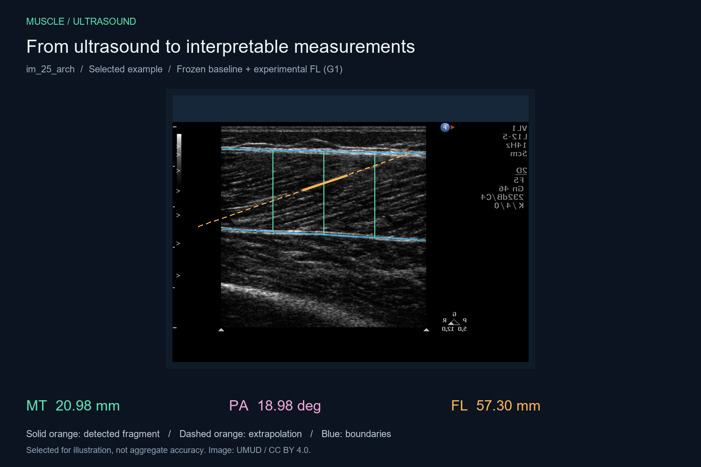
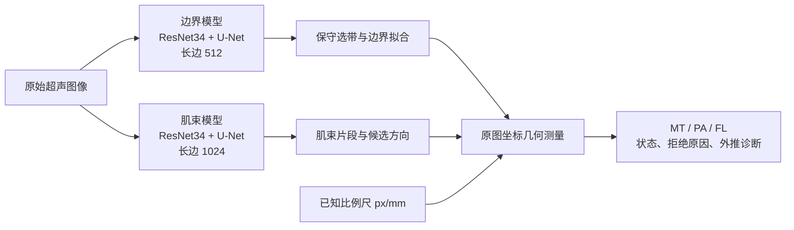

# Muscle Ultrasound

**从超声图像，到可解释的肌肉测量。**

使用两个独立的 **ResNet34-UNet** 识别肌肉上下边界与肌束片段，再通过几何计算估计肌肉厚度（MT）、羽状角（PA）和肌束长度（FL）。这是一个仍在验证中的研究原型。

**[打开交互展示 →](https://wangyh666-ust.github.io/muscle-ultrasound/)** · [模型与评估说明](docs/MODEL_CARD.md) · [数据来源](ATTRIBUTION.md) · [快照来源](docs/provenance.json)



*精选示例 `im_25_arch`。实线表示检测到的片段，橙色虚线表示几何外推。为了清楚展示当前能力，首页选择了表现较好的图；它们不是随机样本，也不代表整体准确率。交互页可切换完整的 34 张外部开发图，包括失败案例。*

## 可以看到什么

- 在 **原图 / 分割掩码 / 测量叠加** 之间切换。
- 查看上下边界、三个厚度位置、角度选线、长度选线及外推交点。
- 对比 **G0 严格视野规则**与 **G1 实验性外推规则**。
- 查看逐图输出、实际候选数量及探索性的专家均值对照。
- 查看固定分母覆盖率和失败案例，而不只看精选图。

页面展示的是**已冻结的缓存预测**，不在浏览器执行神经网络，也不支持上传图片现场推理。

## 当前架构



展示使用固定 apo 模型与 **Round13 B ResNet34-UNet** 肌束模型。两个网络分别输出 mask，并非 Transformer 与 CNN 的混合模型。方向辅助监督、分段边界拟合等后续实验未替换这份展示基线。

FL 通过肌束直线与两条边界求交计算；PA 与 FL 独立选线，没有将 `FL = MT / sin(PA)` 直接当作最终输出。G1 允许交点在画面或边界支持区之外，但仍保留其他接受条件，包括不超过 80% 的外推比例。

## 整体表现：先看分母

以下使用相同的 **34 张外部开发图**，不是精选图统计，也不是独立盲测。

| 参数 | 有输出 / 全部 | 成功子集的探索性 MAE |
|---|---:|---:|
| 厚度 MT | 33 / 34 | 2.86 mm，n=33 |
| 角度 PA | 33 / 34 | 2.07°，n=33 |
| 长度 FL · G0 | 4 / 34 | 4.49 mm，n=4 |
| 长度 FL · G1（实验） | 25 / 34 | 8.79 mm，n=25 |

**输出率不是准确率。** 不同参数的 MAE 分母不同，不能横向据此评出优劣；失败没有填零或插补。专家表中 MT/FL=mm、PA=degree 仍是工作假设，完整测量协议也未确认，因此这些是探索性误差，**不是正式准确率或 Kaggle 分数**。毫米换算使用数据包提供的尺度，不是自动读尺结果。

更大的隔离开发集（282 图 / 279 组）上，同一固定模型和几何方案的 G1 输出为 **154 / 282**、G0 为 **17 / 282**，说明上述外部 34 图的覆盖不能直接外推。详见 [模型卡](docs/MODEL_CARD.md)。

## 已知局限与正在研究的问题

- **长度是主要瓶颈。** 短肌束片段需延长到边界；方向与边界的小误差可能放大为明显长度误差。
- **有输出也可能选错边界。** 展示页保留 `im_06_arch`、`im_20_arch` 等异常案例。
- **短线 mask 不是完整肌束长度真值。** 像素 Dice 改善不保证最终 PA/FL 改善。
- **后续方向监督实验尚未支持更换默认模型。** Round26.1 的 dev 覆盖改善，但外部共同 20 图 FL 探索性 MAE 从 7.89 增至 9.13 mm；该轮还有工程与统计审计项待收尾。
- 34 张图已反复用于开发分析，不能充当独立测试，也未证明患者相互独立。本项目尚不支持临床使用。

## 在本地打开展示

下载仓库后，直接双击 **`docs/index.html`**。展示数据使用本地 JavaScript 文件加载，不需要模型、GPU、Python 或网络 CDN。

也可以启动静态服务：

```bash
python -m http.server 8000 --directory docs
```

然后打开 `http://localhost:8000`。

## 推理代码

仓库包含统一测量入口及其依赖的精简源码，代码从研究工作区按字节复制；**不包含训练集或 checkpoint**。因此可以浏览全部示例，但下载仓库后尚不能直接运行新图推理。

已有兼容权重时，可安装推理依赖：

```bash
python -m venv .venv
# 激活虚拟环境后；PyTorch 的 CUDA 构建按本机环境选择
pip install -r requirements-inference.txt
python scripts/measure_umud.py --help
```

单图推理示例（需要自行提供两个兼容 checkpoint）：

```bash
python scripts/measure_umud.py --image /path/to/image.tif --image-id example --px-per-mm 7.7 --apo-checkpoint /path/to/apo.pt --fasc-checkpoint /path/to/fasc.pt --out runs/example --device cpu
```

`--px-per-mm` 可省略；缺少可靠尺度时保留像素几何，不生成毫米值。不要为了运行示例而猜测真实图像的尺度。仅加载可信来源的 PyTorch checkpoint。

模型哈希、源码哈希及冻结结果哈希见 [`docs/provenance.json`](docs/provenance.json)。本仓库是独立发布快照，不包含内部试验历史、论坛缓存、密钥、原始训练数据或完整实验日志。全部科研回放需要原研究工作区中的数据和产物。

附带的 29 项几何测试可独立运行：`python -m unittest discover -s tests -v`。它们验证几何实现，不代表真实测量准确率。

## 数据与许可

展示中的超声图像来自 **UMUD benchmark muscle architecture dataset v0.1.0**，来源与 CC BY 4.0 许可见 [ATTRIBUTION.md](ATTRIBUTION.md)。公开快照中只包含用于展示的 34 张图和派生叠加信息；这不是对整个比赛数据的再发布。第三方图像许可不等于代码许可；本快照暂未指定代码开源许可证。

---

**English:** Research prototype for muscle ultrasound segmentation and interpretable geometry-based measurement. Two independent ResNet34 U-Nets predict aponeuroses and fascicle fragments. The static demo exposes all 34 external development cases, including failures. Selected examples illustrate current behavior, not population accuracy. G1 fascicle lengths are experimental extrapolations; reference-unit assumptions and repeated development-set use limit accuracy claims. No training data or model weights are included.
